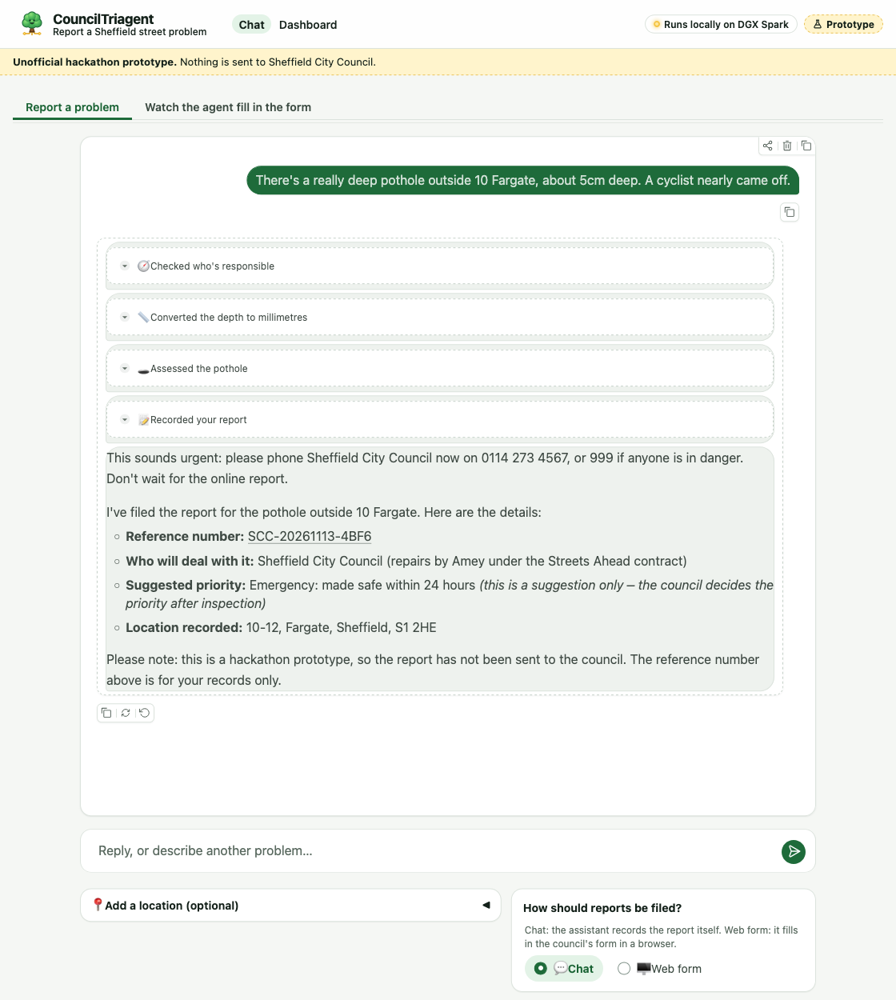
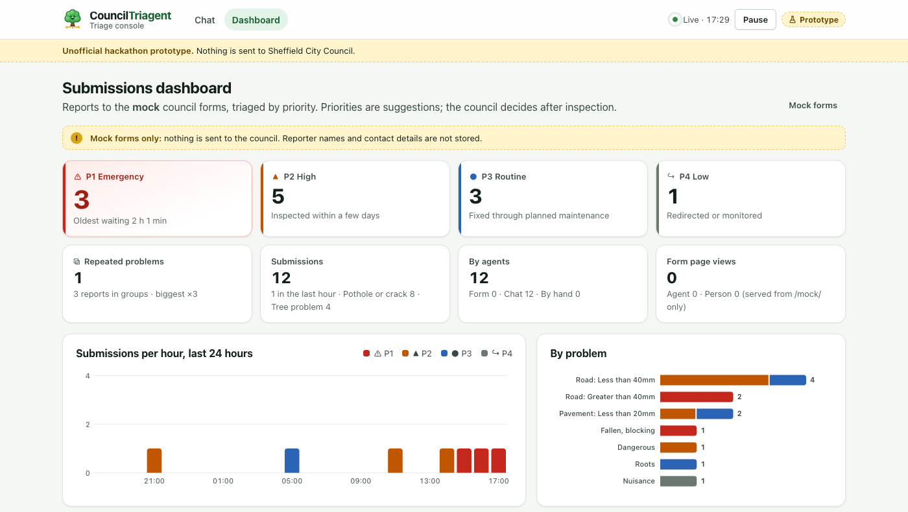
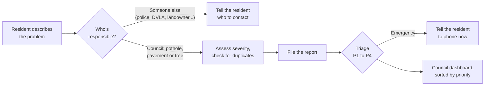

<p align="center">
  
</p>

# CouncilTriagent

[](https://github.com/rcgsheffield/hack-for-impact/actions/workflows/deploy.yml)

**Report a street problem in plain words. A local AI agent works out who is responsible, files the report and triages it for the council.**

This is our entry for the NVIDIA [Hack for Impact Sheffield](https://events.nvidia.com/hack-for-impact-sheffield/) hackathon (13 November 2026), in the **Public Services** track. Everything runs on local compute: the models (Nemotron and Qwen) run through Ollama on an NVIDIA DGX Spark.

> [!NOTE]
> This is an unofficial hackathon prototype. It files reports against mock copies of Sheffield City Council's forms, and nothing is sent to the council.

## The problem

To report a pothole or a fallen branch, you have to know who owns it (the council, National Highways, a private landowner, the DVLA or the police), find the right form and answer questions like "is it deeper than 40 mm?". Many people phone instead, and council staff then re-key and triage those reports by hand.

## What it does

**For residents:** describe the problem in the chat, and optionally add a photo or a map pin. The agent asks at most one follow-up question, checks who is responsible, assesses severity against the council form's rules and files the report with a reference number. If it's urgent, it tells you to phone straight away.



**For council staff:** a live dashboard lists every report, sorted by suggested priority (P1 Emergency to P4 Low) with the reasons. Duplicate reports of the same problem are grouped on a map, and a group moves up the queue as more people report it.



The agent can also fill in the council's web form itself in a browser, page by page, while you watch ("Watch the agent fill in the form" tab).

## How it works



The routing rules are in [`docs/sheffield-council-services.md`](docs/sheffield-council-services.md) and the triage rules in [`docs/triage.md`](docs/triage.md). The prototype covers potholes, pavement defects and street trees.

**Stack:** Python, FastAPI, a Gradio chat UI, LangChain tool calling, and Playwright for the browser agent. Each job goes to a suitable local model on the Spark's Ollama: `nemotron-3.5-lightning:30b` for the chat and triage, and `qwen3.6:35b-a3b` for the browser agent and photos (see `src/app/models.py`).

## Run it

Needs [uv](https://docs.astral.sh/uv/) and access to an Ollama server.

```bash
uv sync
uv run pytest                                        # no GPU or model needed
ssh -N -L 11434:127.0.0.1:11434 <user>@<spark> &     # tunnel to Ollama on the Spark
uv run uvicorn app.main:app --app-dir src --reload   # http://127.0.0.1:8000
uv run python -m app.demo_seed                       # optional: fill the dashboard with demo reports
```

| Page | What it is |
|---|---|
| `/` | Resident chat |
| `/dashboard` | Council triage dashboard |
| `/mock/` | Mock council forms that the agents fill in |
| `/health` | Status, including the model and Ollama version |

Settings (`OLLAMA_URL`, `OLLAMA_MODEL` and others) and a map of the code are in [`docs/getting-started.md`](docs/getting-started.md). Every push to `main` deploys to the DGX Spark ([`docs/deployment.md`](docs/deployment.md)).

## Repository layout

```
src/app/              The app: agent, tools, triage, web UI (static/)
src/hack_for_impact/  LangChain agent runner used by the chat
src/mock/             Mock copies of the council's report forms
tests/                pytest suite (uses a fake model, so it runs anywhere)
data/                 Small public FixMyStreet samples; runtime logs (git-ignored)
docs/                 Design notes, routing and triage rules, deployment
video/                Pitch video, built with HyperFrames
deploy.sh             Deploy script run on the Spark by GitHub Actions
```

## Documentation

| Doc | Contents |
|---|---|
| [`challenge.md`](docs/challenge.md) | Hackathon brief, tracks and judging criteria |
| [`getting-started.md`](docs/getting-started.md) | Code map, local run, settings, checking the deployed app |
| [`sheffield-council-services.md`](docs/sheffield-council-services.md) | Who owns what: routing rules for the agent |
| [`triage.md`](docs/triage.md) | Priority scale, rules, the LLM's role, evaluation, demo seed |
| [`browser-agent.md`](docs/browser-agent.md) | The agent that fills in web forms in a browser |
| [`form-agents.md`](docs/form-agents.md) | Testing the form agents locally |
| [`open311.md`](docs/open311.md) | The Open311 standard for civic issue reports |
| [`deployment.md`](docs/deployment.md) | Self-hosted runner, `deploy.sh`, Caddy |
| [`spark-ollama.md`](docs/spark-ollama.md), [`smoke-test.md`](docs/smoke-test.md) | The shared Ollama on the Spark, and a GPU smoke test |
| [`data-sources.md`](docs/data-sources.md) | Public datasets and provenance |
| [`pitch-video-guide.md`](docs/pitch-video-guide.md) | Advice for the five-minute demo video |

## Team

**Dependency Hell's Angels:** Edwin Brown, Farhad Allian, Joe Heffer and Shaun Donnelly.

## Licence

[MIT](LICENSE)
