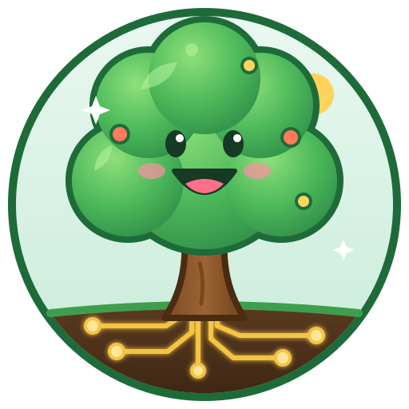

<p align="center">
  
</p>

# Hack for Impact

[](https://github.com/rcgsheffield/hack-for-impact/actions/workflows/deploy.yml)

> Build autonomous systems that think, act, and run anywhere, whilst also making a positive impact on the world.

Our entry for the NVIDIA [Hack for Impact Sheffield](https://events.nvidia.com/hack-for-impact-sheffield/) hackathon, **Friday 13 November 2026, 09:00 – 20:00**.

## Challenge

We are building an agentic AI solution that runs on local compute and delivers real-world impact in one of three tracks:

| Track | Focus | Goal |
|-------|-------|------|
| **Economic Systems** | How money flows through businesses, workers and markets | Agentic systems that help people and organisations make better economic decisions, unlock opportunities or optimise costs |
| **Public Services** | How people access and interact with public services and resources | Data-driven tools that make public systems easier to navigate, more efficient and more user-friendly |
| **Urban Operations** | How cities run, from large-scale infrastructure to everyday life | Systems that improve how cities function behind the scenes and in real time |

Tracks describe a theme of impact, not the scope of the idea. Any solution that delivers against a theme is eligible.

### Judging criteria

- **Impact**: does the solution address a real problem?
- **Technical execution**: how well does it use agentic AI and local compute?
- **Feasibility**: could it realistically be built or deployed beyond the hackathon?

## Chosen track and idea

_TBD. Fill this in once the team has decided._

- **Track:**
- **Problem:**
- **Who benefits:**
- **Approach:**

## Data sources

Public datasets are available, and none is mandatory:

- [Sheffield City Council Open Data portal](https://data.sheffield.gov.uk/), including Sheffield Local Insight neighbourhood indicators
- [data.gov.uk](https://www.data.gov.uk/)
- [Office for National Statistics (ONS)](https://www.ons.gov.uk/)

Keep downloaded datasets in `data/`. Raw files are git-ignored by default, so record where each came from in [`data/README.md`](data/README.md).

## Repository layout

```
.
├── docs/       Challenge brief, design notes, pitch material
├── data/       Local datasets (not committed) and their provenance
├── src/        Application and agent code
├── video/      Pitch video, built with HyperFrames (see video/README.md)
├── LICENSE
└── README.md
```

## Getting started

The barebones app in [`src/app/`](src/app/) is a stdlib-only Python server (no install step). It serves a chat page at `/`, forwards `/chat` to the local Ollama, and reports status at `/health`.

Run it locally: `OLLAMA_URL=http://<spark>:11434 python3 src/app/server.py`, then open <http://localhost:8000>. Settings are `PORT` (8000), `OLLAMA_URL` (`http://127.0.0.1:11434`) and `OLLAMA_MODEL` (`nemotron-3.5-lightning:30b`).

**Check the deployed app:** `src/app/check.sh` (or `curl http://spark12.local:8000/health`). It returns `{"ok": true, ...}` with the deployed commit's short SHA, or HTTP 503 if Ollama is unreachable. The chat page is at <http://spark12.local:8000>.

On the Spark, `deploy.sh` runs the app as the systemd user service `hack-app` (`src/app/hack-app.service`) and fails the deploy if `/health` doesn't go green within 15 seconds. One-time setup on the Spark so the service survives logout and reboot: `sudo loginctl enable-linger $USER`. Logs: `journalctl --user -u hack-app`.

### Deployment (DGX Spark)

Every push to `main` deploys to the DGX Spark through a GitHub Actions [self-hosted runner](https://docs.github.com/en/actions/hosting-your-own-runners) on that machine (`.github/workflows/deploy.yml`). The runner connects out to GitHub, so the Spark needs no inbound access. The workflow runs [`deploy.sh`](deploy.sh), which syncs the code to `~/hack-for-impact` on the Spark (its local `data/` is kept) and then starts the app. To redeploy without pushing, use **Actions → Deploy to DGX Spark → Run workflow**.

One-time runner setup, done on the Spark over SSH:

1. In GitHub, go to **Settings → Actions → Runners → New self-hosted runner**, choose **Linux / ARM64**, and follow the download steps it shows.
2. Configure the runner with the `spark` label and install it as a service:
   ```bash
   ./config.sh --url https://github.com/rcgsheffield/hack-for-impact --token <TOKEN> --labels spark --unattended
   sudo ./svc.sh install && sudo ./svc.sh start
   ```
3. Make sure `rsync` is installed. If the app will use Docker, add the runner's user to the `docker` group.

### Smoke test (GPU + Ollama)

The Spark's organisers run a shared Ollama container, `spark-hack-ollama`, with `nemotron-3-nano:30b`, `nemotron-3.5-lightning:30b` and `qwen3.6:35b-a3b`. **Use it for all local inference**: don't run our own Ollama, and don't pull or unload models on it, because other teams share it. The runner's user can't use Docker.

[`src/smoke/smoke_test.sh`](src/smoke/smoke_test.sh) checks that endpoint end to end with only `curl` and `python3`. It confirms Ollama is reachable, checks that the model is listed, generates a reply and fails if the model isn't resident in VRAM. The **Smoke test** workflow (`.github/workflows/smoke.yml`) runs it on the Spark for pull requests touching `src/smoke/`, or via **Actions → Smoke test → Run workflow**; it never deploys. Set the endpoint and model with the repository variables `OLLAMA_URL` (default `http://127.0.0.1:11434`) and `OLLAMA_MODEL` (default `nemotron-3-nano:30b`). Locally: `OLLAMA_URL=http://<host>:11434 REQUIRE_GPU=0 src/smoke/smoke_test.sh`.

### Local LLM (Ollama)

The Spark already runs an organiser-provided Ollama container (`spark-hack-ollama`) on `localhost:11434`, with Nemotron and Qwen models downloaded. It clashes with the smoke stack's port. See [`docs/spark-ollama.md`](docs/spark-ollama.md) for the models, how to call it and how to stop it.

## Team

_Add team members here._

## Licence

Released under the [MIT License](LICENSE).
